# קהוט שיעור 6 - מפתח תשובות למורה

* מעלים ל-Kahoot את `kahoot_lesson6.xlsx` (Create → Import spreadsheet), ואז מצרפים לכל שאלה את התמונה `kahoot_images/qNN.png`.
* אחרי כל שאלה מריצים את קובץ ההדגמה מתוך `kahoot_demos/` כדי לראות את התשובה "בחיים האמיתיים". את השינוי מוצאים לפי `# <-- changed` / `# <-- new`.

## סיבוב 1: נחשו מה יקרה

### שאלה 1 (30 שניות)

שינינו את המספר ב-clock.tick. מה יקרה למשחק?

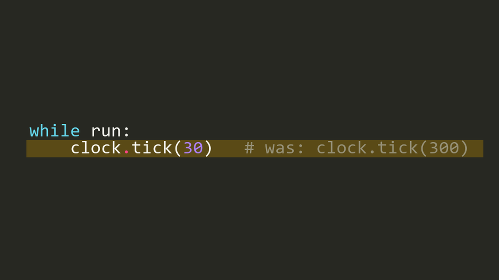

1. הכול יזוז לאט פי 10 ✅
2. הכול יזוז מהר פי 10
3. הדינוזאור יקפוץ גבוה יותר
4. המשחק יקרוס עם שגיאה

**למה:** clock.tick(N) אומר: לכל היותר N פריימים בשנייה. בכל פריים כל דבר זז פיקסל אחד, אז 30 במקום 300 = הכול לאט פי 10.

**הדגמה:** `kahoot_demos/q01.py`

### שאלה 2 (30 שניות)

החלפנו מינוס בפלוס בציור הדינוזאור בזמן קפיצה. מה יקרה כשנלחץ על רווח?

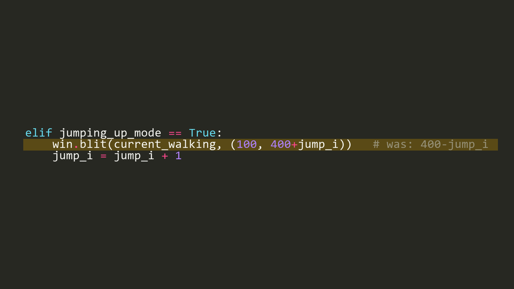

1. הדינוזאור יקפוץ גבוה פי 2
2. הדינוזאור 'יקפוץ' למטה וייעלם מתחת למסך ✅
3. הדינוזאור יזוז ימינה
4. שום דבר לא ישתנה

**למה:** על המסך y גדל כלפי מטה! 400+200 = 600, והחלון גבוה רק 500 - הדינוזאור יורד מתחת למסך ואז חוזר.

**הדגמה:** `kahoot_demos/q02.py`

### שאלה 3 (30 שניות)

מחקנו את השורה השנייה שמציירת את הרקע. מה נראה על המסך?

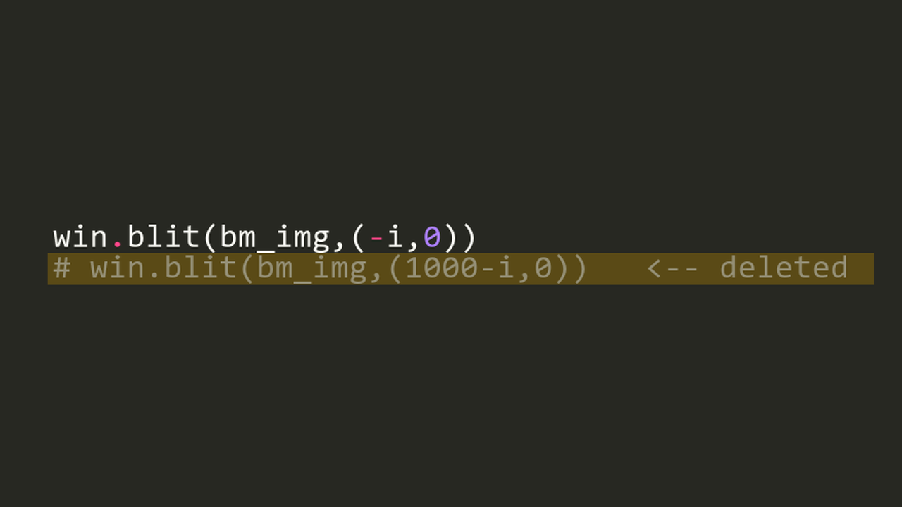

1. הרקע יפסיק לזוז
2. בצד ימין ייפתח 'חור' שהולך וגדל ✅
3. הרקע יזוז מהר פי 2
4. שום דבר - ציור אחד מספיק

**למה:** הרקע הראשון זז שמאלה, ומימין לו לא מצויר כלום - נשארות שם 'מריחות' מהפריימים הקודמים. בגלל זה מציירים את הרקע פעמיים, אחד אחרי השני.

**הדגמה:** `kahoot_demos/q03.py`

### שאלה 4 (30 שניות)

שינינו את 200 ל-50. מה יקרה לקפיצה?

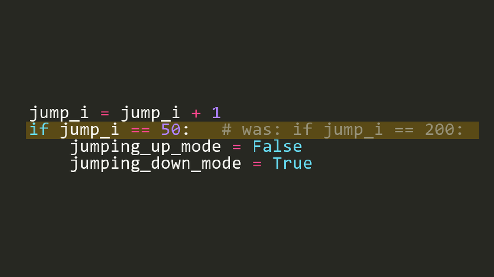

1. קפיצה נמוכה וקצרה - קשה יותר לתזמן ✅
2. קפיצה גבוהה יותר
3. הדינוזאור לא ינחת לעולם
4. המשחק יקרוס עם שגיאה

**למה:** הדינוזאור עולה רק 50 פיקסלים ונמצא באוויר 100 פריימים במקום 400 - צריך ללחוץ ממש ברגע הנכון.

**הדגמה:** `kahoot_demos/q04.py`

### שאלה 5 (30 שניות)

מחקנו את pygame.display.update() מתוך לולאת המשחק. מה נראה?

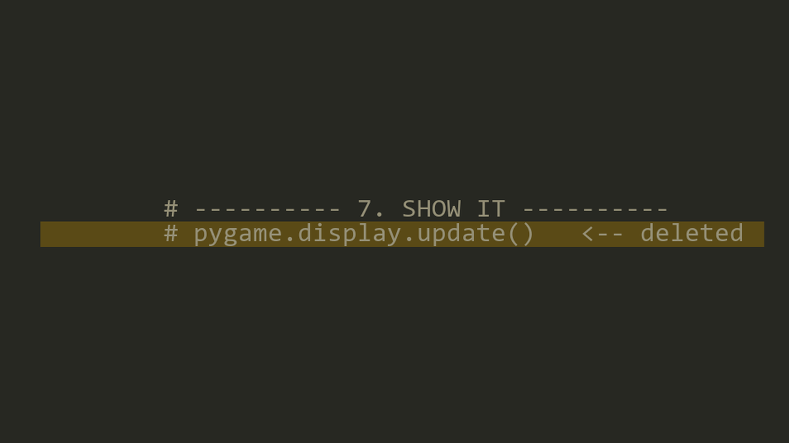

1. המשחק ירוץ כרגיל
2. המסך יישאר שחור (עד ה-Game Over) ✅
3. רק הדינוזאור לא יופיע
4. שגיאה: חסרה פקודה

**למה:** כל ה-blit מציירים 'מאחורי הווילון'. רק update מראה את התמונה. המשחק רץ, אבל לא רואים כלום - עד שה-Game Over קורא ל-update משלו.

**הדגמה:** `kahoot_demos/q05.py`

### שאלה 6 (30 שניות)

העברנו את ציור הרקע אל אחרי ציור הדינוזאור. מה יקרה?

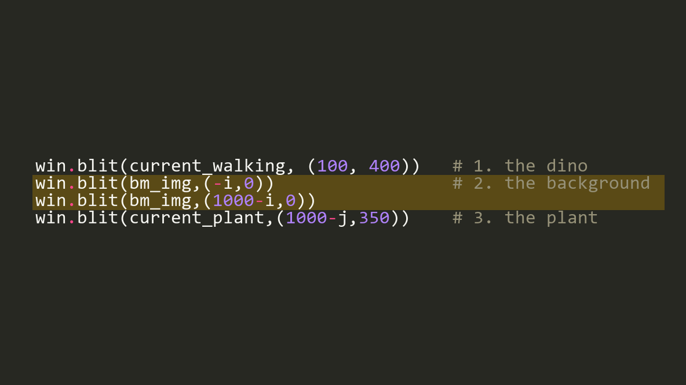

1. הדינוזאור ייעלם - הרקע מכסה אותו ✅
2. הרקע ייעלם
3. שום דבר - הסדר לא משנה
4. הצמח והציפור ייעלמו

**למה:** כמו מדבקות: מה שמציירים אחרון נמצא למעלה. הרקע מכסה את הדינוזאור, אבל הצמח והציפור מצוירים אחרי הרקע - אז רואים אותם.

**הדגמה:** `kahoot_demos/q06.py`

### שאלה 7 (30 שניות)

הציפור עפה עכשיו גבוה בשמיים (y=100). אם לא נקפוץ ולא נתכופף - מה יקרה?

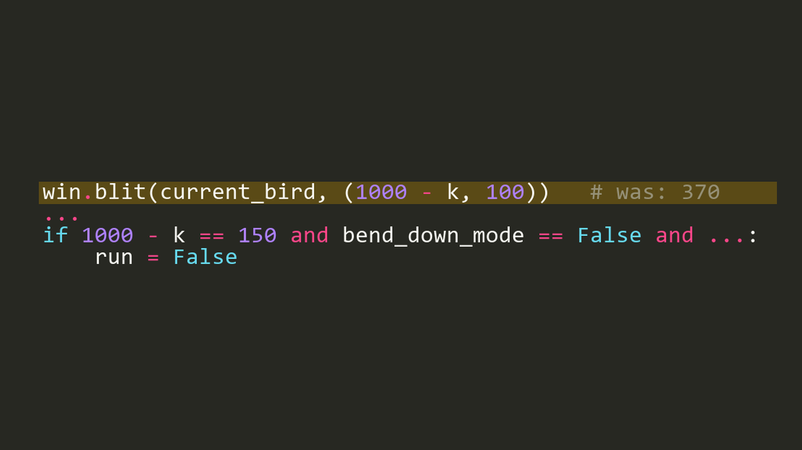

1. הציפור עוברת מעל - לא נפסלים
2. נפסלים! הקוד בודק רק את x ✅
3. הציפור תיעלם
4. הציפור תנחת על הדינוזאור

**למה:** מה שרואים על המסך ומה שהקוד בודק - שני דברים שונים! בדיקת ההתנגשות מסתכלת רק על x של הציפור, לא על הגובה.

**הדגמה:** `kahoot_demos/q07.py`

## סיבוב 2: ציידי באגים

### שאלה 8 (60 שניות)

אחרי Game Over החלון 'לא מגיב' ואי אפשר לסגור אותו. למה?

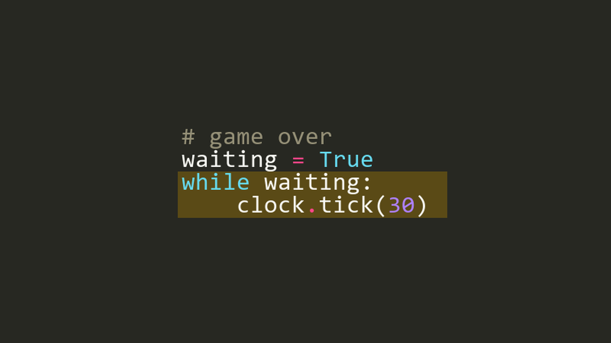

1. clock.tick(30) איטי מדי
2. אף אחד לא קורא ל-pygame.event.get() ✅
3. waiting צריך להתחיל כ-False
4. חסר pygame.init()

**למה:** Windows מחכה שהתוכנה תטפל באירועים (לחיצות, סגירה). לולאה שלא קוראת ל-event.get נראית 'תקועה' - וגם ה-X לא עובד. זה הבאג שתיקנו במשחק!

**הדגמה:** `kahoot_demos/q08.py (עוצרים עם Ctrl+C או כפתור Stop)`

### שאלה 9 (60 שניות)

התמונה כן נמצאת ב-lesson6/res. אז למה השגיאה?

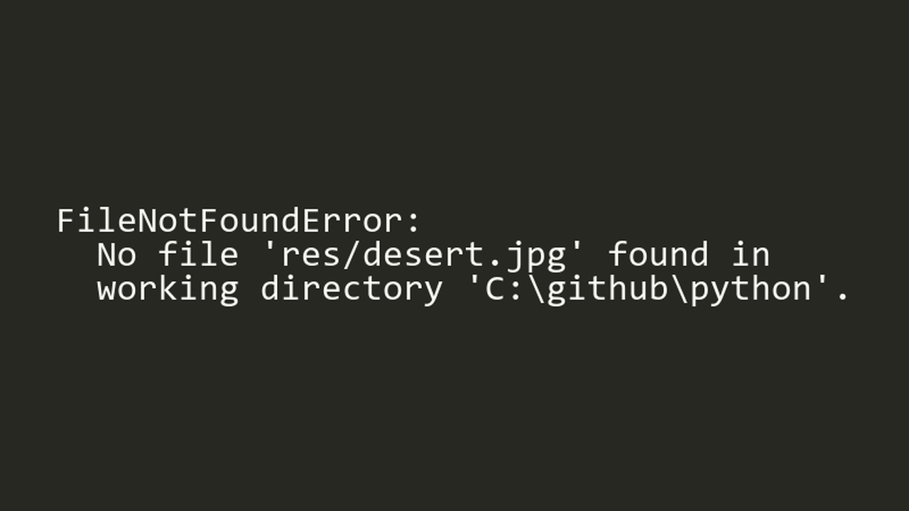

1. קובץ התמונה פגום
2. pygame לא תומך בקבצי jpg
3. פייתון מחפש בתיקייה שממנה הרצנו, לא ב-lesson6 ✅
4. צריך להוסיף pygame.init() לפני

**למה:** נתיב יחסי (res/...) מחושב מהתיקייה הנוכחית. התיקון: os.chdir לתיקייה של הקובץ - השורה שבראש dino_birds.py.

**הדגמה:** `kahoot_demos/q09.py (מריצים מהתיקייה C:\github\python)`

### שאלה 10 (60 שניות)

קפצנו בזמן, הדינוזאור עף מעל הציפור - ובכל זאת Game Over! למה?

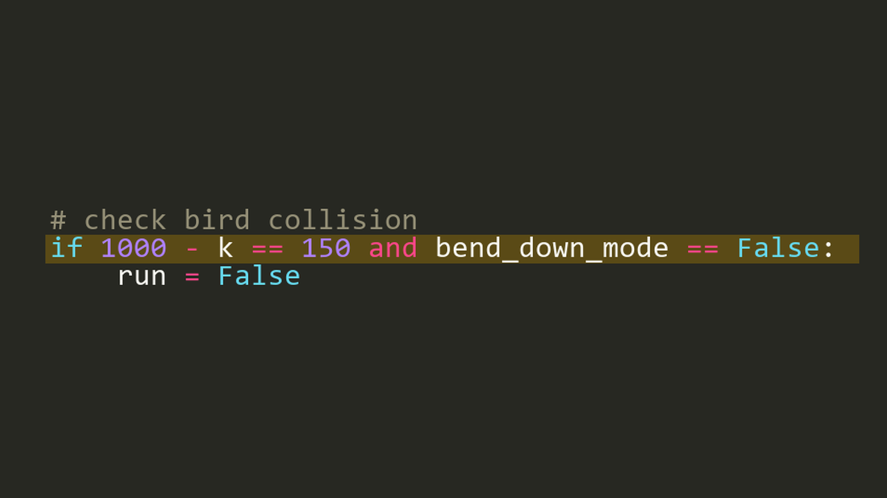

1. התנאי לא בודק אם הדינוזאור באוויר ✅
2. הציפור מהירה מדי
3. צריך = במקום ==
4. k מתחיל מ-400 במקום מ-0

**למה:** הבאג המקורי של המשחק: אפשר היה רק להתכופף מתחת לציפור. התיקון: להוסיף and jumping_up_mode == False and jumping_down_mode == False.

**הדגמה:** `kahoot_demos/q10.py`

### שאלה 11 (60 שניות)

שינינו ל-i=i+3 כדי שהרקע ירוץ מהר. אחרי כמה שניות הרקע 'נעלם'. למה?

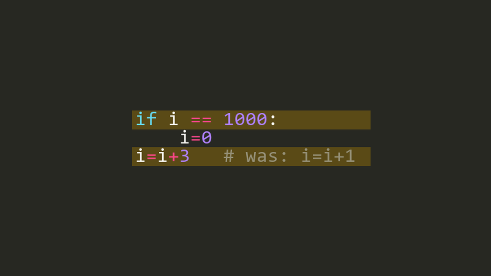

1. i אף פעם לא שווה בדיוק 1000 ✅
2. המחשב לא מספיק מהיר
3. תמונת הרקע קטנה מדי
4. צריך לכתוב i=i+3.0

**למה:** i עובר 0, 3, 6 ... 999, 1002 - ומדלג מעל 1000! לכן לא מתאפס והרקע בורח. התיקון: if i >= 1000.

**הדגמה:** `kahoot_demos/q11.py`

### שאלה 12 (60 שניות)

לוחצים על X כדי לסגור באמצע משחק - והחלון לא נסגר. מה הבאג?

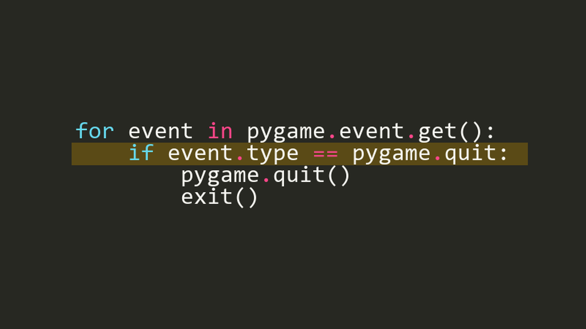

1. צריך pygame.QUIT באותיות גדולות ✅
2. צריך = במקום ==
3. חסר exit() בסוף הקובץ
4. צריך event.key במקום event.type

**למה:** פייתון מבדיל בין אותיות גדולות לקטנות. pygame.QUIT = סוג האירוע 'סגירת חלון'. pygame.quit = פונקציה שסוגרת את pygame. ההשוואה תמיד False.

**הדגמה:** `kahoot_demos/q12.py`

## סיבוב 3: תכנתו בעצמכם

### שאלה 13 (60 שניות)

איך נהפוך את כל המשחק למהיר פי 2?

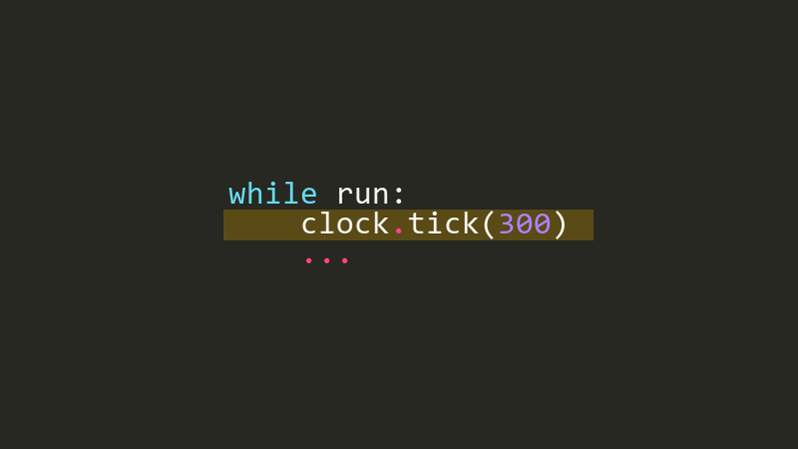

1. `clock.tick(600)` ✅
2. `clock.tick(150)`
3. `win = pygame.display.set_mode((2000,1000))`
4. `pygame.init(2)`

**למה:** פי 2 פריימים בשנייה = הכול זז פי 2 מהר. (במחשב איטי ייתכן שלא יגיע ל-600.)

**הדגמה:** `kahoot_demos/q13.py`

### שאלה 14 (60 שניות)

איזה שינוי יגרום לדינוזאור לקפוץ גבוה יותר?

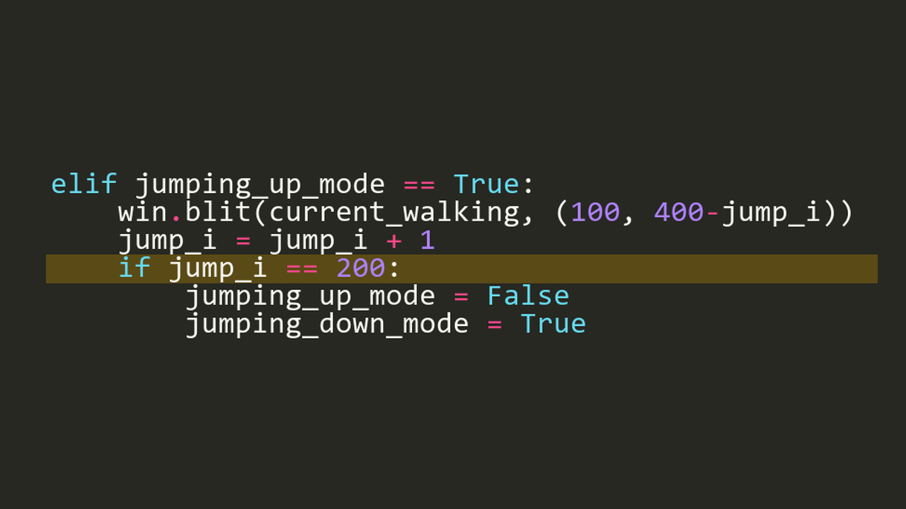

1. `if jump_i == 300:` ✅
2. `win.blit(current_walking, (100, 300-jump_i))`
3. `if (bend_i == 300):`
4. `jump_i = jump_i - 1`

**למה:** jump_i הוא הגובה. הקפיצה עולה עד ש-jump_i מגיע ל-200 - אם נשנה ל-300 היא תעלה 300 פיקסלים. (שינוי 400 ל-300 ירים את הדינוזאור באוויר רק בזמן קפיצה.)

**הדגמה:** `kahoot_demos/q14.py`

### שאלה 15 (60 שניות)

רוצים שגם חץ למעלה יקפיץ את הדינוזאור. איזו שורה נכונה?

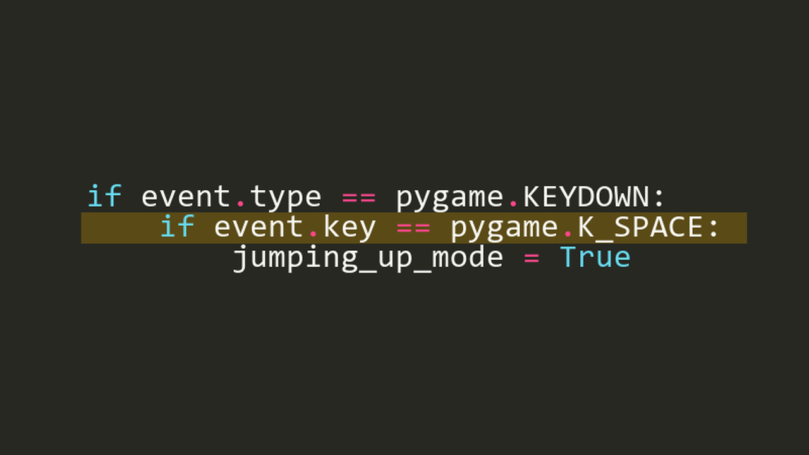

1. `if event.key == pygame.K_SPACE or pygame.K_UP:`
2. `if event.key == pygame.K_SPACE or event.key == pygame.K_UP:` ✅
3. `if event.key == pygame.K_SPACE and event.key == pygame.K_UP:`
4. `if event.type == pygame.K_UP:`

**למה:** מלכודת קלאסית: 'or pygame.K_UP' לבד הוא תמיד True (מספר שאינו 0), אז כל מקש מקפיץ. 'and' לעולם לא True - מקש אחד לא יכול להיות גם רווח וגם חץ.

**הדגמה:** `kahoot_demos/q15.py (והמלכודת: q15_trap.py - כל מקש מקפיץ!)`

### שאלה 16 (60 שניות)

איך נעשה את הדינוזאור גדול פי 2?

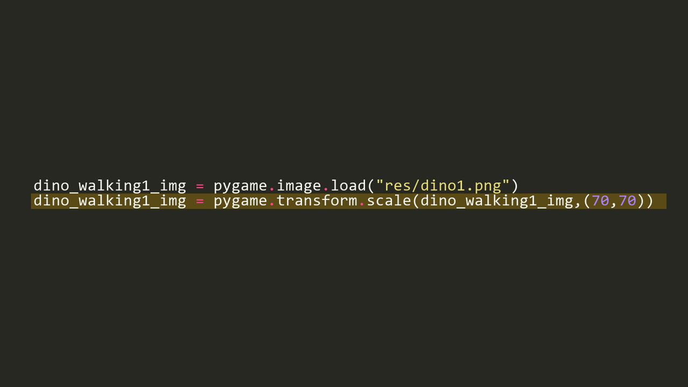

1. `pygame.transform.scale(dino_walking1_img,(140,140))` ✅
2. `pygame.display.set_mode((2000,1000))`
3. `win.blit(current_walking, (200, 800))`
4. `dino_walking1_img = dino_walking1_img * 2`

**למה:** transform.scale קובע את גודל התמונה. שימו לב: הרגליים יוצאות מהמסך - צריך גם להזיז את y של הדינוזאור מ-400 ל-330.

**הדגמה:** `kahoot_demos/q16.py`

## בונוס: מוסיפים ניקוד

### שאלה 17 (90 שניות)

נוסיף ניקוד! איזה קוד מציג את המספר score בפינה הימנית העליונה של החלון?

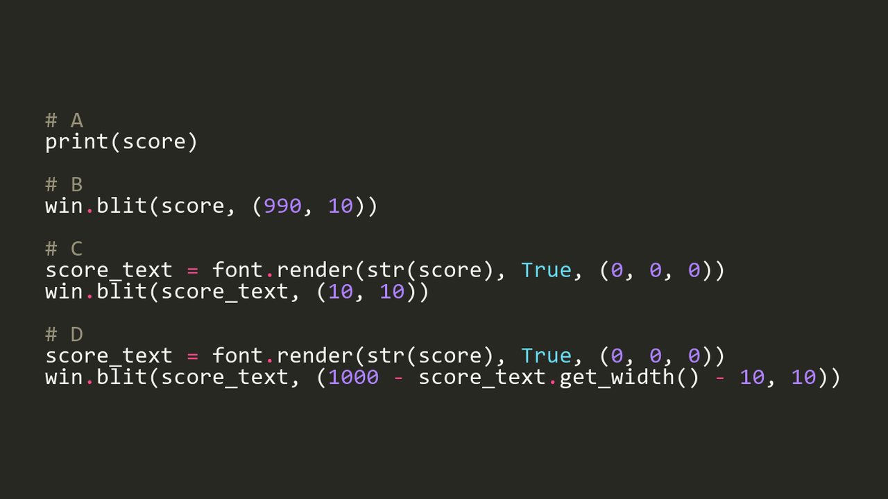

1. `A`
2. `B`
3. `C`
4. `D` ✅

**למה:** A מדפיס לטרמינל, לא לחלון. B קורס - blit מצייר רק תמונה (Surface), לא מספר. C בפינה השמאלית. D: font.render הופך טקסט לתמונה (str כי render מקבל רק טקסט), ו-x = רוחב החלון פחות רוחב הטקסט. חשוב: לפני display.update()!

**הדגמה:** `kahoot_demos/q17.py`

### שאלה 18 (90 שניות)

איפה נוסיף score = score + 1 כדי לספור רק קפיצות מוצלחות מעל צמח?

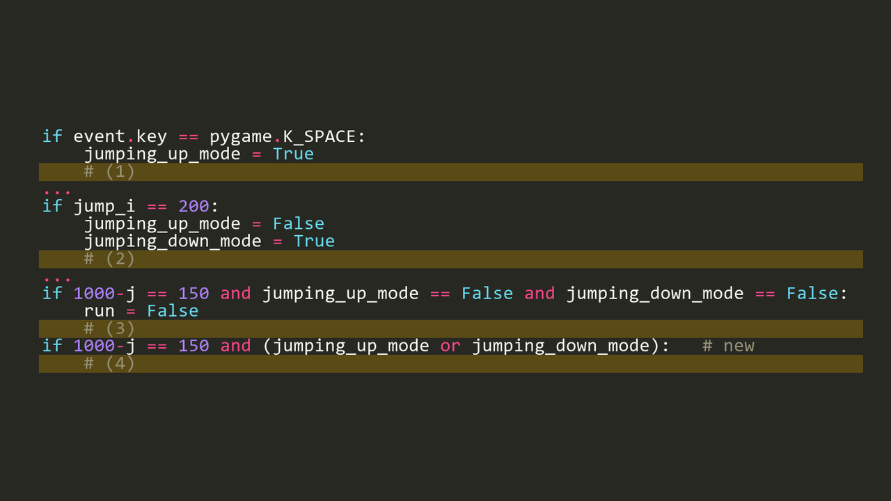

1. מקום 1
2. מקום 2
3. מקום 3
4. מקום 4 ✅

**למה:** 1 סופר לחיצות (גם קפיצות סתם). 2 סופר כל קפיצה שמגיעה לשיא. 3 סופר פסילות! 4: הצמח הגיע לדינוזאור והוא באוויר = קפיצה מוצלחת. וגם: score = 0 באיפוס המשחק.

**הדגמה:** `kahoot_demos/q18.py`